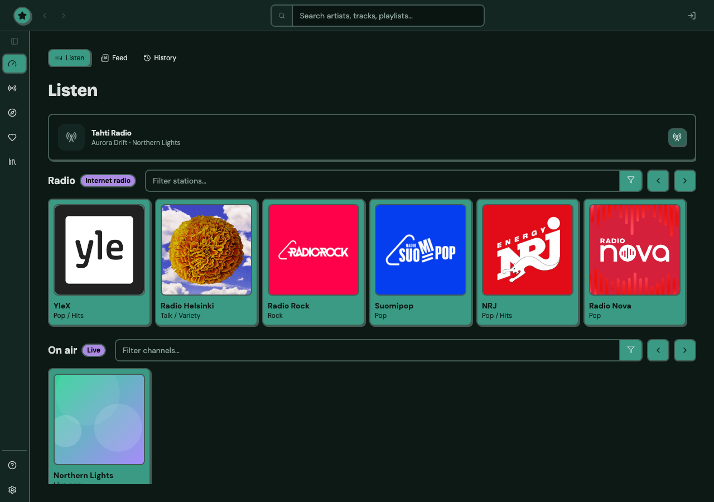
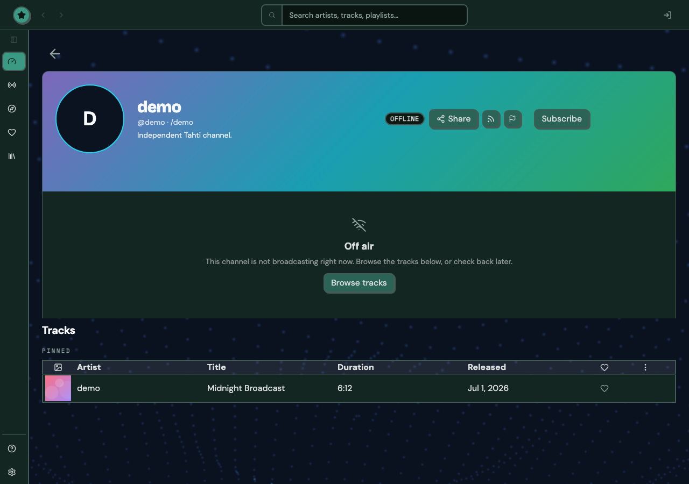
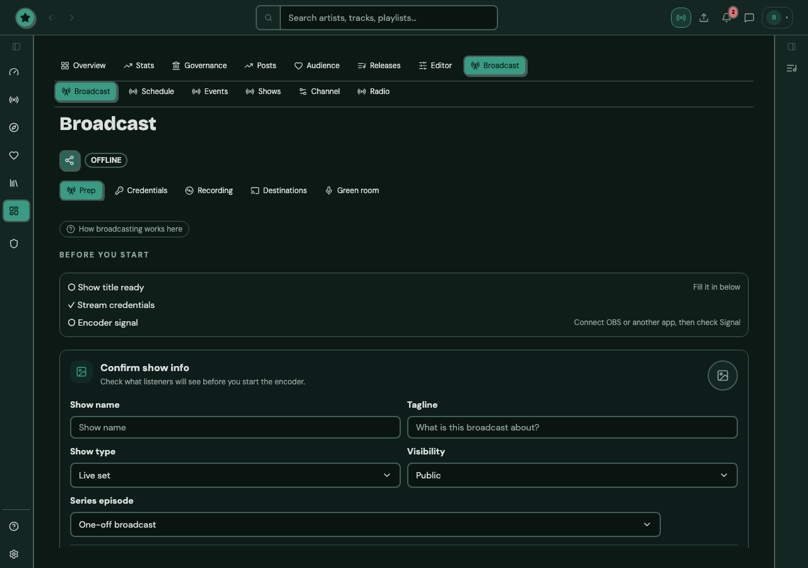

# Tahti Player

**Tahti Player** is the app for [Tahti](https://tahti.live), a Finnish nonprofit broadcasting platform owned by its members. Independent artists run their own channels: they go live, publish music and earn directly from their fans. Listeners tune in without ads or tracking. The community runs the platform together.

It runs in the browser at **[tahti.live](https://tahti.live)** and as a desktop app for Windows, macOS and Linux. iOS and Android supported for mobile. Native chromecast / airplay support.

<picture><source media="(prefers-color-scheme: light)" srcset="./packages/tahti-web/docs/redesign-shots/listen-home-v1--light.png" /></picture>

## For listeners

Free to use, no account needed to listen.

- **Live channels and archives.** Watch artists broadcast live, or replay past shows and tracks.
- **Tahti Radio.** A 24/7 stream with a weekly schedule of live shows, plus a curated set of Finnish internet radio stations.
- **Discover.** New releases, trending tracks, upcoming shows, venues and artist profiles with their news and events.
- **Chat.** Talk with the artist and other listeners during a broadcast, with live emoji reactions.
- **Your library.** Follow artists, like and repost tracks, build playlists and pick up where you left off.
- **Support artists directly.** Subscribe to an artist, buy tracks, and unlock fan-only downloads and chat rooms.

<picture><source media="(prefers-color-scheme: light)" srcset="./packages/tahti-web/docs/redesign-shots/listen-channel-v1--light.png" /></picture>

## For artists

Your channel, your music, your income.

- **Go live.** Stream from OBS to your channel and to other platforms at the same time. Invite guests into a green room before the show.
- **Publish.** Upload tracks, build releases and albums with full credits, and share them with smart links and embeds.
- **Program your channel.** Schedule shows and keep a 24/7 rotation running when you're offline.
- **Design it.** Set your channel's look, backdrop, logo and press kit.
- **Earn.** Offer fan subscription tiers and paid tracks, and get paid out through Stripe. Distribute to streaming services from the studio.
- **Grow.** See who listens, which links get clicked and how downloads convert. Send updates to your subscribers and auto-post releases to Mastodon and Bluesky.

<picture><source media="(prefers-color-scheme: light)" srcset="./packages/tahti-web/docs/redesign-shots/studio-go-live-v1--light.png" /></picture>

## For the community

Tahti is a nonprofit, and its members decide how it is run.

- **Governance.** Members propose and vote on motions and take part in the annual general meeting.
- **Transparency.** Public transparency reports and a live platform status page.
- **Safety.** Anyone can report a track, channel or comment. Members can block accounts and mute mentions.
- **Venues.** Clubs and venues list their upcoming shows, with calendar feeds.
- **Open source.** This app is AGPL-licensed and built in the open. Feature requests come from members.

## Desktop app

Everything from the web app, plus:

- A local music library: import folders, iTunes / Music.app libraries and hearthis.at or SoundCloud sets, with smart playlists and volume normalization.
- Control from other devices: a phone remote, MPD clients and Discord status.
- A built-in [MCP](https://modelcontextprotocol.io/) server, so AI agents on your computer can control playback and search Tahti. See [`packages/docs/integrations/mcp-server.md`](./packages/docs/integrations/mcp-server.md).

There's also a command-line client, `tahti`, for managing your library, uploading folders and listening from the terminal. See [`packages/tahti-cli`](./packages/tahti-cli/README.md).

## More screens

The [view guide](./packages/tahti-web/docs/VIEW-GUIDE.md) has screenshots of every screen, grouped by listeners, channels and community, the artist studio and administration.

## Development

Requirements: Node.js 24 and pnpm 10 (`corepack enable`). The desktop app also needs Rust and the [Tauri 2](https://v2.tauri.app/start/prerequisites/) system dependencies; the web app doesn't.

```bash
git clone https://github.com/janiluuk/tahti-player.git
cd tahti-player
pnpm install

pnpm dev:tahti                     # web app at http://localhost:5180
VITE_FORCE_MOCK=1 pnpm dev:tahti   # offline demo: sign in as demo@tahti.live (artist) or listener@tahti.live, any password
pnpm dev                           # desktop app
pnpm storybook                     # component library

pnpm lint && pnpm type-check && pnpm test
```

| Package | What it is |
| --- | --- |
| `@tahti-player/tahti-web` | The web app: listening, artist studio and board admin |
| `@tahti-player/player` | The desktop app (Tauri) |
| `@tahti-player/ui`, `themes` | Shared components and themes |
| `@tahti-player/tahti-cli` | The `tahti` command-line client |
| `@tahti-player/tahti-ops` | Maintainer tooling: deploys, stack, tests |

The API lives in [janiluuk/tahti-org](https://github.com/janiluuk/tahti-org). Its public docs are at [api.tahti.live/api](https://api.tahti.live/api). How the pieces fit together: [`docs/ARCHITECTURE.md`](./docs/ARCHITECTURE.md). Web app details and configuration: [`packages/tahti-web/README.md`](./packages/tahti-web/README.md).

## Contributing

Talk to the maintainers before large changes. AI agents should start with [AGENTS.md](./AGENTS.md).

## License

[AGPL-3.0-only](./LICENSE)
