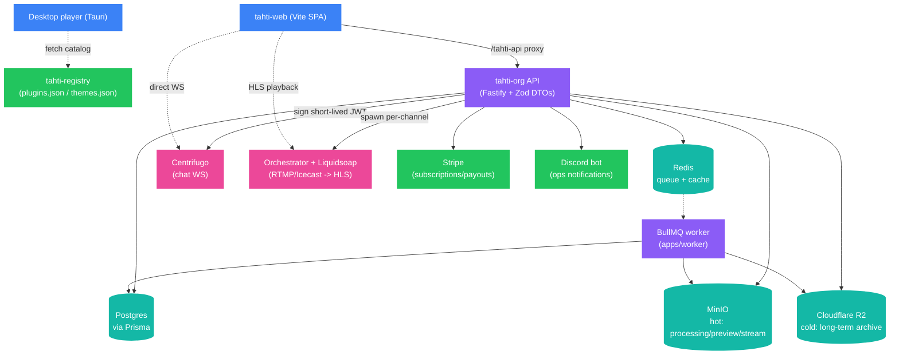

# Architecture

System-level overview: what talks to what, and why. For how a specific
request/upload/broadcast actually moves through these pieces step by step,
see [`DATA-FLOW.md`](./DATA-FLOW.md).

## Repos

| Repo | Role |
| --- | --- |
| **`tahti-player`** (this repo) | Desktop player (Tauri) + `tahti-web` (listen/studio/admin SPA, the only web client) + shared UI/plugin/theme packages. No server code. |
| **`../tahti-org`** | Fastify API, Prisma/Postgres, BullMQ worker, orchestrator, `@tahti/shared` / `@tahti/ui` / `@tahti/api-client` / `@tahti/addon-sdk`, static marketing `website/`, infra and ops. Its Next.js `apps/web` was removed on 2026-10-28 (#1030). |
| **`../tahti-registry`** | Static JSON catalog (`plugins.json`, `themes.json`) for the desktop player's marketplace — fetched directly from `raw.githubusercontent.com`, no CDN layer. |

## System

## Clients

- **`tahti-web`** is a pure Vite SPA — no server of its own. Every public host
  (apex, `www`, `app`, `beta`, `admin`, `staging`, `<slug>.tahti.live`, radio,
  embed) goes through Pi4 Nginx Proxy Manager to one nginx container
  (`tahti-beta-web`, vimage `:15180`) that serves `dist/`. It
  calls the API same-origin through that container's `/tahti-api` proxy; in dev, either that
  proxy (`VITE_TAHTI_API_PROXY_TARGET`) or an absolute URL
  (`VITE_TAHTI_API_URL`, CORS). `VITE_FORCE_MOCK=1` short-circuits every
  fetcher to fixture data — no network calls, no API needed.
- **Desktop player** is Tauri (Rust + React): local library, unsandboxed
  plugins, and local servers answered by tahti-web's player: MCP for AI
  agents (`127.0.0.1:8800/mcp`) and MPD (`127.0.0.1:6600`), both this
  computer only, and the
  Tahti Jam phone remote (LAN, ports 4120+, paired devices only); plus
  Discord Rich Presence. Since 2026-09-01 the desktop window renders
  tahti-web, not Nuclear's UI. It fetches the
  plugin/theme marketplace catalog directly from `tahti-registry` on GitHub —
  that path never touches the Tahti API.

## API & data

Fastify + Prisma/Postgres is the system of record. Redis backs both the
BullMQ job queue and general caching. Object storage is split by
temperature, sharing one S3-compatible client shape
(`apps/api/src/lib/{minio,r2}.ts` in `tahti-org`):

- **MinIO** — hot reads: processing, preview, active streaming.
- **Cloudflare R2** — cold, long-term store.

## Live broadcast

An artist's encoder (OBS or any RTMP/Icecast source) pushes to an ingest
host; the API asks a separate **orchestrator** service to spawn a
per-channel **Liquidsoap** process, which produces the HLS output (plus
multistream) that listeners actually play. Chat is a parallel path: the API
signs a short-lived HS256 JWT and the client uses it to connect **directly**
to Centrifugo's websocket — chat traffic never round-trips through the API
after that handshake.

Live health: after a restart the orchestrator respawns the Liquidsoap
containers of channels still marked LIVE, and its watchdog treats a channel
with no HLS segments as stale (tahti-org #1028). The API's
`/api/v1/status` includes a `live-streams` check that lists silent LIVE
channels (critical for Tahti Radio and the curated rotation), shown on the
admin Status page and exported as the Prometheus gauge
`tahti_live_streams_silent` (tahti-org #1031, tahti-player #1703).

## Deploy

- **tahti-player `master`** → CI → `deploy-tahti-web-selfhosted.yml` builds
  `tahti-web` on vimage and restarts the `tahti-beta-web` container, which
  serves every public web host. Details: [`packages/tahti-web/deploy/README.md`](../packages/tahti-web/deploy/README.md).
- **tahti-org `main`** → green CI → `deploy-production.yml` runs
  `scripts/deploy_prod.sh` (docker compose up `--remove-orphans` on vimage)
  for the API, worker, orchestrator and the rest of the stack. The `v*`-tag
  Swarm `deploy.yml` path is dormant.

## Background jobs

The BullMQ worker (`tahti-org/apps/worker`) drains jobs off Redis:
transcoding, waveform/editor-peaks generation, audio fingerprinting
(ACRCloud/AcoustID — powers tracklist auto-identification), stem separation,
newsletter/social-post dispatch, ledger rollups and fan-sub payouts, and
scheduled sweeps (expired stems, missed live shows). None of this runs
inline in an API request — uploads/edits land in Postgres in a `PROCESSING`
state and flip to `READY` (or `FAILED`) once the matching job finishes.

## Reference

- [`DATA-FLOW.md`](./DATA-FLOW.md) — the same system, traced through three
  concrete flows (listen, studio publish, go-live).
- [`PLUGIN-REGISTRY.md`](./PLUGIN-REGISTRY.md) — installed-plugin registry vs marketplace catalog, storage format, bootstrap order.
- [`../TAHTI.md`](../TAHTI.md) — product framing and repo relationship.
- [`../AGENTS.md`](../AGENTS.md) / [`../AGENTS-START-HERE.md`](../AGENTS-START-HERE.md) — where to work in this repo.
