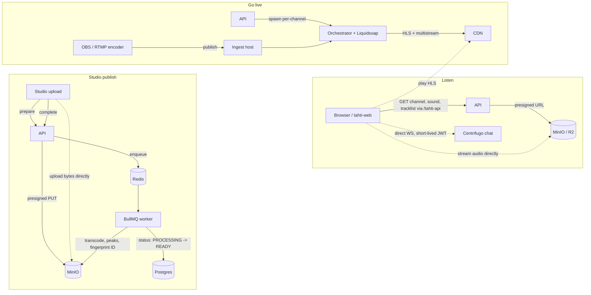

# Data flow

One thesis: **the API is the hub.** Every client reads and writes through
it; it's the only thing that talks to Postgres, and it's what hands out the
short-lived credentials (presigned upload URLs, Centrifugo JWTs) that let
clients then talk to storage and chat *directly*, without the API in the
loop for every byte.

The same flow in words:

- **Listen** — `tahti-web` asks the API for what to show (channel metadata,
  a sound's tracklist, a release). For anything binary, the API hands back
  a presigned URL instead of the bytes; the browser then streams audio and
  loads images straight from storage. Chat is the same pattern: the API
  signs a short JWT once, and the browser holds an open websocket to
  Centrifugo directly.
- **Studio publish** — an upload is a three-step handshake with the API
  (prepare → direct-to-storage PUT → complete), not a single big POST. The
  API's job on "complete" is just to enqueue work; a BullMQ worker (drained
  off Redis) does the actual transcoding, waveform-peaks generation, and
  audio fingerprinting, writing results back to storage and flipping the
  track's Postgres status from `PROCESSING` to `READY` (or `FAILED`) when
  it's done. Nothing in this path blocks an API request on ffmpeg.
- **Go live** — the API never touches the media stream itself. It only
  tells a separate orchestrator service to spawn a per-channel Liquidsoap
  process, which takes the artist's RTMP/Icecast source and produces the
  HLS (+ multistream) output listeners actually play from the CDN. Chat
  during a live show rides the same direct-to-Centrifugo path as Listen.
  If a LIVE channel's playlists stop updating, the `live-streams` status
  check reports it (see [`ARCHITECTURE.md`](./ARCHITECTURE.md#live-broadcast)).

## Waveform peaks contract

The worker writes `peaks` (600 amplitude buckets, `0..255`) on the sound
while it is `PROCESSING`; every list and detail payload that can draw a
waveform returns them. The browser never fetches or decodes audio to draw a
waveform: `@tahti-player/ui` `Waveform` only takes `peaks`, and a READY
sound with `peaks: null` draws calm flat bars (`data-waveform="empty"`),
never a loading pulse. Missing peaks are a data gap for the API backfill,
not something the client works around. Only the Studio Pro editor decodes
audio, for its zoomable detail.

| List | Mapper (`packages/tahti-web/src`) | Endpoint |
| --- | --- | --- |
| Channel tracks | `soundItemToPlayable` (`api/mock.ts`) | `GET /api/channels/:slug/items` |
| Artist profile tracks, Feed fallback, directory cards | `profileTrackToPlayable` (`lib/artistProfile.ts`), `fetchArtistPlayables` (`api/client.ts`) | `GET /api/v1/u/:username/profile` |
| Collections, channel playlist block | `collectionSoundToPlayable`, `ChannelPlaylistBlock` | `GET /api/v1/collections/:slug` |
| Studio collection editor | studio collection playables | `GET /api/me/collections/:slug` |
| Smart link / release page | `smartLinkPlayables` | `GET /api/v1/r/:slug` |
| Likes (own, artist) | `likedTrackToPlayable` (`api/likes.ts`) | `GET /api/me/likes`, `GET /api/v1/u/:username/likes` |
| Listen new tracks, Discover latest, Tahti Selects, New to you | `galleryItemToTrack` + `discoverTrackPlayable` | `GET /api/discover/latest-tracks`, `GET /api/v1/tahti-selects/gallery`, `GET /api/discover/new-to-you` |
| Discover top / loved widgets | `useDiscoverTrackPlayback` fallback | `GET /api/tracks/:id` on play |
| Search, tag search | `searchTrackPlayable` | `GET /api/v1/search` |
| Radio Just played, Feed track cards | radio and feed playables | `GET /api/v1/radio/recently-played`, `GET /api/me/feed` |
| Studio sounds | `SoundsAmbientList` | `GET /api/me/sound` |
| Track page, player bar, queue | `PlayerWaveform` / `WaveformSeekbar` from the playable's `peaks` (`playerStore.peaksById` keeps them across skips) | the list the track was played from, or `GET /api/tracks/:id` |

Mock mode has a peaks catalog at `/channel/yaniho`: twelve READY sets, all
with peaks except `yaniho-archive-9`, so both states show
(`e2e/use-cases-waveforms.spec.ts`).

See [`ARCHITECTURE.md`](./ARCHITECTURE.md) for what each box is (and where
its code lives); this page is only about the shape of the traffic between
them.
