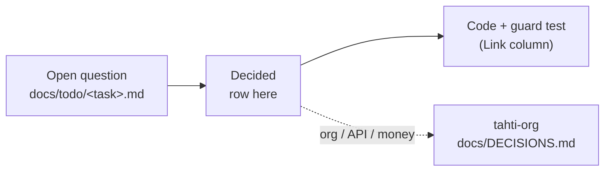

# Decisions

Settled forks for this repo (player, `tahti-web`, UI, tooling) so agents do not re-litigate them. Append new rows; do not rewrite old ones. When a decision is superseded, add a new row that says so.

Org, money, governance, API and infra decisions live in [`tahti-org/docs/DECISIONS.md`](https://github.com/janiluuk/tahti-org/blob/main/docs/DECISIONS.md) (`../tahti-org/docs/DECISIONS.md` locally).

`-` in the Date column: undated, recorded before this log kept dates.

## Repo and workflow

| Date | Decision | Why | Link |
| --- | --- | --- | --- |
| 2026-09-05 | Sibling API/org checkout path is **`../tahti-org`** (not `../tahti`). Registry remains `../tahti-registry`. | - | `AGENTS-START-HERE.md`, `TAHTI.md` |
| 2026-09-05 | Completed agent todos fold into `docs/todo/HISTORY.md` and are deleted; active backlog is `docs/todo/INDEX.md` + open-only `WORKPLAN.md`. | - | `CLAUDE.md`, `AGENTS-START-HERE.md` |
| 2026-09-05 | `UI-REDESIGN-WORKLOG.md` is an append-only ship diary, not the open backlog. | - | `AGENTS-START-HERE.md` |
| 2026-09-05 | Root `AGENTS.md` is short; deep topics live under `docs/agent/*`. | - | `AGENTS.md` |
| 2026-09-05 | WORKPLAN is epics only; leaf tasks are `docs/todo/INDEX.md`. | - | `WORKPLAN.md` |
| 2026-10-19 | **Ops CLI is separate from product `tahti`.** Maintainer scripts fold into `@tahti-player/tahti-ops` (`tahti-ops`). Product `@tahti-player/tahti-cli` stays API/TUI-only. | Product CLI must not ship deploy SSH tooling. | `packages/tahti-ops`, `docs/todo/tahti-ops-cli.md` |

## Plugins and add-ons

| Date | Decision | Why | Link |
| --- | --- | --- | --- |
| - | Marketplace catalog is `tahti-registry`; runtime install list is on-disk `plugins.json`. | Do not migrate the runtime registry until an adapter/contract is accepted. | root `AGENTS.md` |
| - | Import-provider Configure lives in this player repo (modal: settings → test → save/enable). | Do not parallel-configure in Tahti core. | root `AGENTS.md` |
| - | Page widgets configure from Settings → Add-ons, not a second Widgets settings section. | - | `packages/tahti-web/AGENTS.md` |
| 2026-09-16 | **AI DJ:** self-hosted/local LLM, not BYOK; platform stations only for v1 (`tahti-radio`, `tahti-selects`; per-artist opt-in later); additive to human `AnnouncementClip`s and distinguishable from them. | Tahti has free local LLM capacity; editorial integrity for a nonprofit broadcaster; easy to disable and audit. | [`todo/ai-dj-radio-dj-port.md`](todo/ai-dj-radio-dj-port.md) |
| 2026-09-18 | **Add-ons browser has three audience lists:** listener, artist (artists + board), admin (board only). Legacy category deep links map to the right list; themes stay in their own Settings section. Implemented 2026-09-25. | Simpler than implementation categories; settles the unified-page question. | [`todo/admin-plugin-management-panel.md`](todo/admin-plugin-management-panel.md), `pluginStoreCategories.ts` |
| 2026-10-05 | **Configure lifecycle:** host-rendered modal (not SDK hook). Connection test → `{ ok: true } \| { ok: false, error }`; blocks Save when `connectionTest` is advertised. Save and Enable are separate (Enable only after successful test, or after Save when no test). | No silently enabled unverified provider. | root `AGENTS.md`, `../tahti-org/AGENTS.md` |

## Navigation and layout

| Date | Decision | Why | Link |
| --- | --- | --- | --- |
| - | Governance is split by context: member `/governance`, artist `/studio/governance`, board `/admin/governance` + `/admin/agm`. No duplicate global-rail governance. (Artist part superseded 2026-10-28.) | - | root `AGENTS.md` |
| - | Ordinary pages keep persistent chrome; full-screen player, public share canvases, maximized Pro Editor may hide it. | - | root `AGENTS.md` |
| - | Advisory consultation ≠ binding AGM ballot until the sibling API has bylaws-backed contracts. | - | root `AGENTS.md` |
| 2026-09-28 | **Right rail is the queue only.** Chat and notifications are top-bar controls, never rail views or rail header toggles (supersedes the 2026-09-25 "kept in the rail as header toggles" choice). Channel pages open live chat at `/chat/$slug`. | `RightRailTab` is the single literal `'queue'` so they can't return; `RightRailPanel.test.tsx` guards it. | `stores/layoutStore.ts`, `components/RightRailPanel.tsx` |
| 2026-09-28 | **Status bar is desktop-app only.** The web app never shows the bottom status bar (tracks, notifications, storage). | `shouldShowConnectedStatusBar` takes a required `desktopApp`; `ConnectedStatusBar.web.test.tsx` guards it. | `lib/processingItems.ts`, `components/ConnectedStatusBar.tsx` |
| 2026-09-28 | **Governance documents live in Studio → Governance → Documents**, not in Help. Help keeps only a "Policies and service" section at the bottom (terms, privacy, licence, status, news, admin guide). | Lists are in `content/documentLinks.ts`; `HelpGovernanceDocuments.test.tsx` guards it. | `views/HelpView.tsx`, `views/studio/StudioGovernanceView.tsx` |
| 2026-09-28 | **Never conclude "no channel" from a partial user.** Only `/api/auth/me` (flag `profileLoaded`) says whether an account has a channel; login/TOTP/password-reset responses are summaries. Channel setup, the Studio "channel required" gate and onboarding provisioning wait for `profileLoaded`. | - | `stores/authStore.ts`, `components/ChannelSetupDialog.tsx` |
| 2026-10-19 | **Distribution is a StudioNav sibling** (next to Releases). **`/chat` hub** is sidebar footer / phone More, not a mobile primary tab. Favorites / Library / Help stay under More on phone. | - | `StudioNav.tsx`, `AppShell.tsx`, `navigationActive.ts` |
| 2026-10-28 | **Co-op is its own sidebar item** for members: governance (motions, topics, documents, guide) moves out of Studio. Supersedes the "artist `/studio/governance`" part of the governance split above. | - | [`todo/navigation-simplification.md`](todo/navigation-simplification.md) |
| 2026-10-30 | **Do not push a login screen.** Show what a visitor can already do. Menus that need an account stay visible and grayed out; they do not navigate and do not open sign-in. Favourites is a Library tab (`/library/favorites`); `/favorites` and `/listen/favorites` redirect there. Opening Library or Favourites never opens the sign-in dialog. | Ask for an account only when the action needs one. | `AppShell.tsx`, `LibraryView.tsx`, `anonymousRoutes.ts`, `TAHTI.md` |

## Media and UI

| Date | Decision | Why | Link |
| --- | --- | --- | --- |
| 2026-10-21 | **Waveforms use wavesurfer.js** in one `@tahti-player/ui` `Waveform`. Large previews only (track hero, Studio sound header, edit/upload dialog); ambient rows keep the light canvas. Previews use stored `[0..255]` peaks, the editor decodes audio. wavesurfer draws and seeks only, bound to the global player `media`. Rounded mirrored bars, progress `--primary`. Editor plugins: Regions, Timeline, Minimap, Zoom, Hover (no Envelope / Spectrogram / Record in v1). Desktop deferred. ProWaveform stays as fallback until editor parity. | No new API, no decode for previews, one playback source. | [`todo/wavesurfer-waveforms.md`](todo/wavesurfer-waveforms.md) |

## Hosting and cutover

| Date | Decision | Why | Link |
| --- | --- | --- | --- |
| 2026-08-17 | **i18n approach** (from the deleted `CUTOVER-PHASE0.md`): locales are managed from admin - create a new language and import a CSV whose source column is English. No separate client-only i18n scheme. Not built yet. | - | `packages/tahti-web/CUTOVER.md` |
| 2026-10-28 | **The apex `tahti.live` serves the SPA**, not tahti-org's marketing `website/`. **`beta.tahti.live` 301-redirects to `https://tahti.live`** (nginx in the tahti-web container) until a preprod copy of production exists. Production builds never enable `VITE_ENABLE_DIAGNOSTICS`; the Admin sidebar item depends only on the board role. | - | `packages/tahti-web/deploy/`, `AppShell.tsx` |
| 2026-10-28 | **Board admin is the SPA admin** (`/admin/*` in `tahti-web`). Supersedes the 2026-08-17 "Next `/admin/*` stays canonical" decision. | tahti-org #1030 removed the Next `apps/web`; the SPA serves every public host, `admin` included. | `packages/tahti-web/CUTOVER.md`, `src/router/routes-admin.tsx` |
| 2026-10-28 | **`tahti-web` is the only web client.** No custom-domain host routing (PLAT-051 removed); channel hosts are `<slug>.tahti.live` only. | No channel uses a custom domain. | `packages/tahti-web/CUTOVER.md` |
