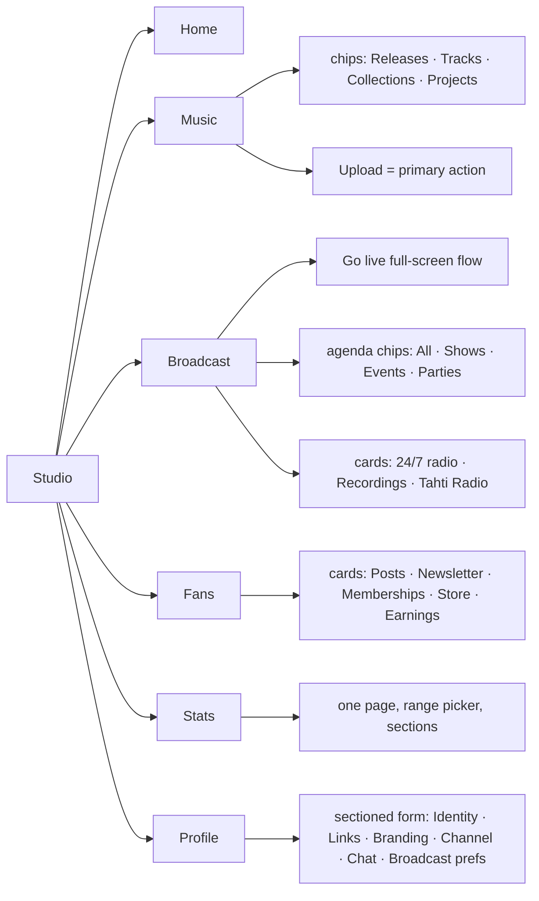
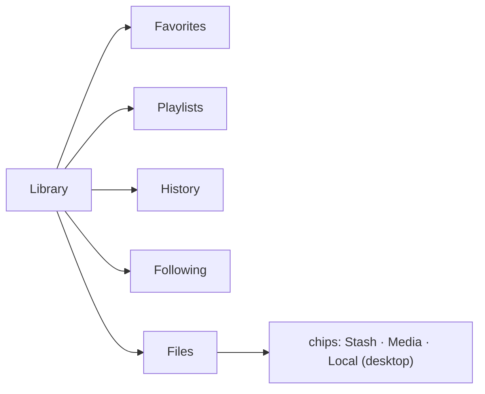
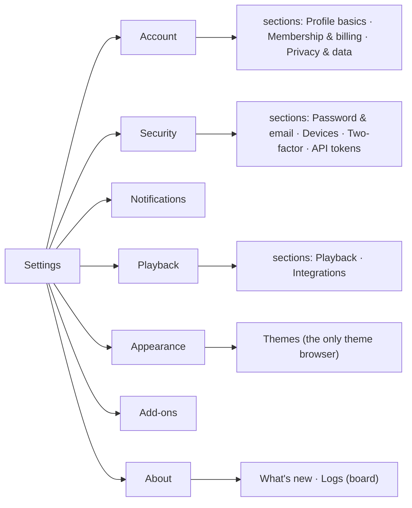
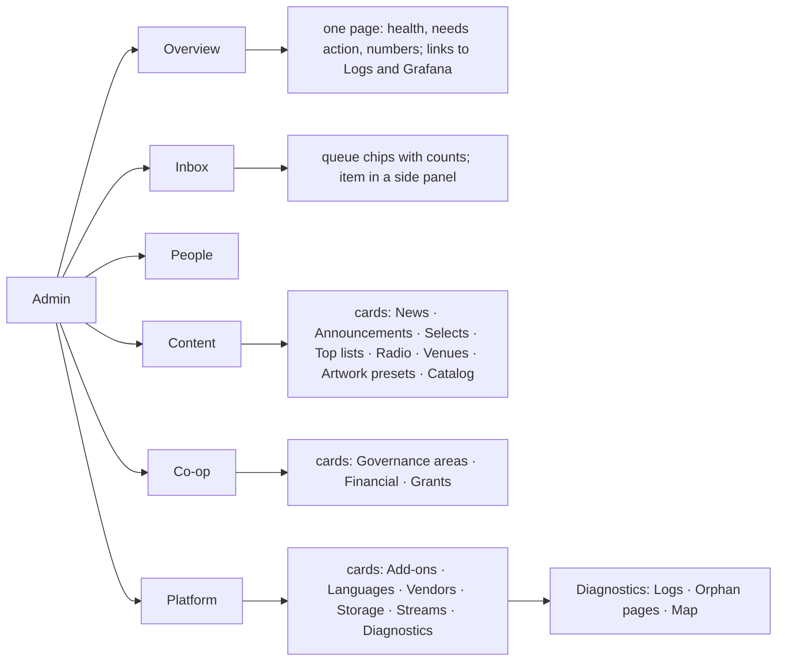

# Simplify Studio, Library, Settings and Admin

**Status:** open

Plan only (2026-11-03); nothing implemented. Goal: a calmer, more professional UI. Every main view has one header, one primary action, one toolbar row and at most one tab row under the section row.

Builds on [`navigation-simplification.md`](navigation-simplification.md) (the IA regroup, slices 1-10). This plan adds **Settings**, **page anatomy** (what sits on a page, not just where it lives) and the duplicate surfaces left after that regroup. Where a phase finishes a slice from that file, it says so; that slice is then ticked there, not re-planned here.

Out of scope (other work in flight): channel page, Listen/Discover, StoryCard/NewsWidget, Chat view, edit/view toggles on collection/playlist/sound/release pages.

## 1. Inventory today (code at `0168d5ed8`)

Counts come from a file-level grep of each view and its folder (`<Button|ButtonLink|...>`, `<Tabs|SectionTabs|InPageNav>`, `<FilterChips|SegmentedControl|Select|Combobox>`, `<Input|Textarea>`). They include dialogs and conditional states, so read them as "how much is on this surface", not as what one screen shows.

### Section rows

| Area | Source | Top-level items | Second level | Tab rows on screen (worst case) |
| --- | --- | --- | --- | --- |
| Studio | `components/StudioNav.tsx` `SUBMENUS['/studio']` | 6: Home · Music · Broadcast · Fans · Stats · Profile | Music: `CatalogSubNav` chips, 3 (Releases · Distribution · Editor). Broadcast: hub of 8 cards. Fans: hub of 5. Profile: hub of 13 | 3 (Studio row → Channel 3 tabs → Radio 5 tabs) |
| Library | `views/LibraryView.tsx` `LIBRARY_SECTION_TABS` | 13 defined; artist on web 12, listener 7, +1 Local files on desktop | Collections and Stash pages add their own tab sets | 2 |
| Settings | `views/settings/settingsNav.ts` `SETTINGS_NAV` (modal, side list) | 10 in 2 groups (Settings 6, App 4) | Account 4 groups → 13 tabs; Artist 3 groups → 8 tabs; Channel 5; Broadcast 3; Themes 2 | 2 inside the modal (group row + tab row) |
| Admin | `components/AdminNav.tsx` `ADMIN_SECTIONS` | 6: Overview · Inbox · People · Content · Co-op · Platform | 23 pages (Overview 3 as a second row; Content 8, Co-op 2, Platform 8 as hubs) | 3 (section row → Overview row, or Governance 7 tabs / Radio 4 / Logs 3) |

### Main views, how much sits on each

| Area | View | Tab sets | Buttons | Filter controls | Inputs | Notes |
| --- | --- | --- | --- | --- | --- | --- |
| Studio | Home (`StudioHomeView` + `home/`) | 0 | 6 | 0 | 0 | 4 empty states on one page |
| Studio | Music → Releases | 0 (Catalog chips) | 10 | 1 | 3 | Catalog split: Sounds and Collections live in Library |
| Studio | Music → Editor list | 3 | 7 | 1 | 2 | In-page tabs under the Catalog chips |
| Studio | Broadcast hub | 0 | 1 | 1 | 0 | 8 cards + agenda chips |
| Studio | Go live (`StudioGoLiveView` + `go-live/`) | 1 (5 tabs) | 23 | 0 | 1 | Prep · Credentials · Recording · Destinations · Green room |
| Studio | Channel (`StudioChannelView`) | 2 (3 + 5) | 3 | 0 | 0 | Setup · Green room · Selects, then Stream · 24/7 · Pinned · Tahti Radio · Multicast |
| Studio | Fans → Posts (`StudioUpdatesView`) | 0 | 11 | 0 | 0 | |
| Studio | Fans → Earnings (`StudioRevenueView`) | 0 | 6 | 0 | 0 | 3 empty states |
| Studio | Stats (`StudioStatsView` + `stats/`) | 0 | 2 | 4 | 2 | Already one page with sections |
| Studio | Profile (`StudioProfileView`) | 0 | 0 | 0 | 0 | 13 cards that all open the Settings modal |
| Studio | Release detail (+ `release-detail/`) | 1 (4 tabs) | 30 | 3 | 8 | Busiest Studio page |
| Library | Overview | 1 | 3 | 0 | 0 | Shows artist storage numbers |
| Library | Sounds (`StudioSoundsView` + `sounds/`) | 1 | 23 | 6 | 4 | Six filter controls |
| Library | Collections (`StudioCollectionsView`) | 5 | 6 | 2 | 4 | |
| Library | Stash (`StudioStashView`) | 6 | 3 | 0 | 0 | Two `ViewShell`s |
| Library | Media, Embeds, Smart links | 0 each | 1 / 0 / 4 | 1 each | 0 | Three separate "files" pages |
| Settings | Account | 2 (groups + tabs) | 6 | 0 | 1 | 13 tabs behind 4 groups |
| Settings | Artist | 2 (groups + tabs) | 5 | 5 | 5 | 8 tabs behind 3 groups |
| Settings | Channel & chat | 1 (5 tabs) | 4 | 0 | 2 | |
| Settings | Broadcast | 1 (3 tabs) | 4 | 0 | 0 | Radio · Green room · Multistream |
| Settings | Themes | 1 (2 tabs) | 6 | 0 | 1 | |
| Admin | Dashboard (`AdminDashboardView`) | 1 (Overview row) | 10 | 0 | 0 | 9 panels incl. System health, Monitoring, Queue health, Cron |
| Admin | Inbox (`moderation/`) | 3 | 40 | 4 | 8 | 7 queue chips |
| Admin | Co-op → Governance (+ `governance/`) | 1 (7 tabs) | 93 | 10 | 51 | Largest surface in the app |
| Admin | Platform → Storage (+ `storage/`) | 1 (2 tabs) | 18 | 8 | 2 | |
| Admin | Platform → Add-ons (+ `addons/`) | 0 | 17 | 4 | 10 | |
| Admin | Platform → Logs | 1 (3 tabs) | 0 | 0 | 0 | |

### Duplication and crowding

| Thing | Where it appears today | Problem |
| --- | --- | --- |
| Artist profile and channel settings | Studio → Profile (13 cards) **and** Settings modal → Artist, Channel & chat | Two entry points; the Studio hub only links into a modal |
| Green room | Settings → Broadcast tab, Go live tab, Studio → Channel tab | Three homes |
| Multistream | Settings → Broadcast "Multistream", Go live "Destinations", Channel → Radio "Multicast" | Three names for nearby things |
| Recordings | Library tab, Broadcast hub card, Go live "Recording" tab | Three homes |
| Catalog | Library: Sounds, Collections, Upload, Embeds, Smart links. Studio → Music: Releases, Distribution, Editor | One job split over two sections |
| Your files | Library: Media, Stash, Local files, Embeds | Four tabs for "things I uploaded or saved" |
| Theme browser | Settings → Themes **and** Settings → Add-ons → Themes category (`plugin-store/ThemesCategory.tsx`) | Two lists of the same themes |
| Health | Admin Dashboard System health + Monitoring panel, Admin Status, Admin Monitoring, Admin Logs, Settings → Logs (board) | Five places to answer "is it up?" |
| Selects | Admin → Content → Tahti Selects, Studio → Channel → Selects (board only) | Admin tool shown inside Studio |
| Co-op membership | Settings → Account → Membership & billing → Governance tab, sidebar Co-op | Two homes |
| Dead code | `BroadcastSubNav` (`StudioNav.tsx:423`) has no callers | Remove |

## 2. Target information architecture

Max 7 top-level items per area. Second level is never another tab row (rule 2 in `navigation-simplification.md`): chips, a sectioned page, or hub cards with a back link.

### Studio (6, unchanged row; contents simplified)

### Library (5, listener-first)

### Settings (account-only, 7)

### Admin (6, unchanged row; fewer second rows)

## 3. Page anatomy rules

| # | Rule | Component (from `@tahti-player/ui` unless noted) |
| --- | --- | --- |
| 1 | One header per page: title, optional one-line subtitle, actions on the right | `ViewShell` (add an `actions` slot) |
| 2 | One primary action per page (filled button). Everything else is secondary | `Button` |
| 3 | At most 2 visible secondary actions; the rest go in an overflow menu (`⋯`) | New `OverflowMenu` (built on `Popover`, `ActionSheet` on mobile) |
| 4 | Filters live in one toolbar row: search, chips, sort, view toggle. Extra filters go in a "Filters" popover | New `FilterBar` composing `Input`, `FilterChips`, `Select`, `SegmentedControl` |
| 5 | One tab row under the section row, at most. Never tabs inside tabs | `Tabs` / `SectionTabs` |
| 6 | Empty states: icon, one sentence, the page's primary action as the only button | `EmptyState` / `PageEmpty` (tahti-web `PageStates`) |
| 7 | Hubs: cards only link; no numbers or forms inside a hub card beyond one status line | `HubCards` |
| 8 | Detail pages: back link + title + at most 4 tabs | `BackButton`, `Tabs` |
| 9 | Long forms: cards of 5-7 fields, each saves on its own, "More options" for the rest | `SettingsPanel`, `SaveButton` |

Budget per main view, checked in each phase:

| Item | Max |
| --- | --- |
| Tab rows (excluding the section row) | 1 |
| Primary buttons | 1 |
| Visible secondary buttons in the header | 2 |
| Toolbar rows | 1 |
| Empty states shown at once | 1 per panel, and only for a panel the user can act on |

## 4. Merge, move, remove

| Action | What | From | To | Absorbs |
| --- | --- | --- | --- | --- |
| Move | Sounds, Collections, Upload, Embeds, Smart links | Library | Studio → Music (chips) | nav-simplification slice 1 |
| Merge | Media, Stash, Local files | 3 Library tabs | Library → Files (chips) | slice 1 |
| Remove | Library Overview tab | Library | Favorites is the landing tab | slice 1 |
| Move | Artist (8 tabs) and Channel & chat (5 tabs) forms | Settings modal | Studio → Profile sectioned page | slice 2 |
| Move | Broadcast prefs (Radio, Green room, Multistream) | Settings → Broadcast | Studio → Profile "Broadcast" section and the Go live flow | new |
| Merge | Green room, Destinations/Multistream, Recording | Go live 5 tabs, Channel tabs, Settings | Go live full-screen steps: check → keys → where to stream → green room | slice 3 |
| Remove | `BroadcastSubNav` | `StudioNav.tsx` | deleted | new |
| Move | Channel → Selects | Studio | Admin → Content only | slice 6 follow-up |
| Merge | Settings → Themes and Add-ons → Themes category | 2 lists | Settings → Appearance; Add-ons links there | new |
| Regroup | Account 4 groups × 13 tabs | 2 tab rows | Account, Security, Notifications as 3 sectioned pages | new |
| Move | Integrations | own section | Playback → Integrations section | new |
| Merge | What's new, Logs | 2 sections | About | new |
| Move | Account → Governance tab | Settings | sidebar Co-op (link from Account) | new |
| Merge | Dashboard, Status, Monitoring | 3 Overview pages | one Overview page | slice 9 |
| Change | Inbox open item | full page | side panel | slice 7 |
| Move | Logs, Orphan pages, Map | Platform hub | Platform → Diagnostics card | new |
| Rewrite | Sitemap, nav gaps, VIEW-CATALOG | docs | from the new structure | slice 10 |

Every moved page keeps its old URL as a redirect.

## 5. Phased rollout

Each phase ships alone, behind no flag, with old URLs redirecting.

| Phase | Scope | Acceptance checks | Storybook / e2e that change |
| --- | --- | --- | --- |
| 0. Building blocks | `ViewShell` `actions` slot; `OverflowMenu`; `FilterBar` | Each has a story with a play (keyboard open/close, overflow items reachable, mobile sheet). No app change | New `OverflowMenu.stories.tsx`, `FilterBar.stories.tsx`; `ViewShell.stories.tsx` |
| 1. Library 5 tabs + Studio Music catalog | Section 4 rows 1-3 | Library row is Favorites · Playlists · History · Following · Files for every role; Music chips show the catalog; old `/library/sounds` etc. redirect; budget met on Music and Files | `LibraryFavorites`, `LibraryFollowing`, `LibraryItemRow`, `StudioNav` stories; `routes-library.spec.ts`, `routes-studio-content.spec.ts`, `nav-chrome.spec.ts` |
| 2. Studio Profile forms | Section 4 rows 4-5 | Profile is one sectioned page with side links and live preview; each card saves alone; Settings has no Artist, Channel, Broadcast; `/settings/artist?tab=…` and `/settings/channel?tab=…` redirect to the matching Profile anchor | `SettingsArtistPanel`, `SettingsChannelPanel`, `SettingsBroadcastPanel` move to Profile stories; `routes-settings-redirects.spec.ts`, `roles-artist-admin-hubs.spec.ts` |
| 3. Broadcast one flow | Section 4 rows 6-8 | Go live is a stepper; Green room, Multistream, Recording each have one home; Channel page has at most one tab row; `BroadcastSubNav` deleted | `StudioGoLiveView` stories; `nav-chrome.spec.ts`; Go live use-case specs |
| 4. Settings account-only | Section 4 rows 9-13 | Settings side list has 7 items; no group-plus-tab double row; one theme browser; Account → Governance links to Co-op | `SettingsView`, `ConnectedSettingsModal`, `SettingsAccountPanel`, `SettingsThemesPanel`, `SettingsIntegrationsPanel`, `SettingsLogsPanel` stories; `routes-settings-redirects.spec.ts` |
| 5. Studio anatomy sweep | Rules 1-6 on Home, Releases, Sounds, Collections, Posts, Earnings, Release detail | Budget table met on each; Release detail header has 1 primary + overflow; Sounds' 6 filter controls in one `FilterBar` | `StudioHomeView`, `StudioReleaseDetailView` stories; `routes-studio-content.spec.ts`, `routes-studio-stats.spec.ts` |
| 6. Admin Overview + Inbox | Section 4 rows 14-15 | Overview has no second row; Status and Monitoring redirect into it; Inbox opens items in a side panel with counts on all 7 chips | `AdminDashboardView`, `AdminStatusView`, `AdminMonitoringView`, `AdminModerationView`, `AdminNav` stories; `use-cases-admin*.spec.ts`, `routes-admin-deep.spec.ts` |
| 7. Admin anatomy sweep | Rules 1-6 on Governance, Storage, Add-ons, Radio; Diagnostics card | Governance 7 tabs become hub cards or chips (no tab row under the hub back link); budget met | `AdminGovernanceView`, `AdminRadioView`, `AdminHubView` stories; `use-cases-admin-2.spec.ts`, `use-cases-admin-3.spec.ts` |
| 8. Docs | nav-simplification slice 10 | `NAVIGATION-SITEMAP.md`, `NAVIGATION-GAPS.md`, `docs/VIEW-CATALOG.md`, `ADMIN_TAB_ONLY_ROUTES`, `navigationStructureStore.ts` match the code | none |

Every phase: Playwright nav check in member, Studio and Admin contexts (persistent chrome rule), `STORYBOOK-SURFACES.md` regenerated by the hook, VIEW-CATALOG row updated.

## 6. Open product questions

| # | Question | Default if nobody decides |
| --- | --- | --- |
| 1 | Should Studio → Profile include broadcast preferences, or should they live only in the Go live flow? | Profile section, linked from Go live |
| 2 | Library Files: one list with chips, or keep Stash separate from Media? | One list with chips |
| 3 | Settings: are Security and Notifications their own items, or sections of Account (5 items instead of 7)? | Own items |
| 4 | Is Integrations a Playback section or its own item for desktop users? | Playback section |
| 5 | Admin Governance: hub cards or chips for its 7 areas? | Hub cards |
| 6 | Admin Content has 8 cards; group Radio, Selects and Top lists as "Programming"? | Keep 8 cards |
| 7 | Does `OverflowMenu` need to support destructive items with confirmation inline, or always via `ConfirmDialog`? | `ConfirmDialog` |
| 8 | Go live as a full-screen takeover (no chrome) or inside Studio chrome? | Takeover, per persistent-chrome exceptions |
