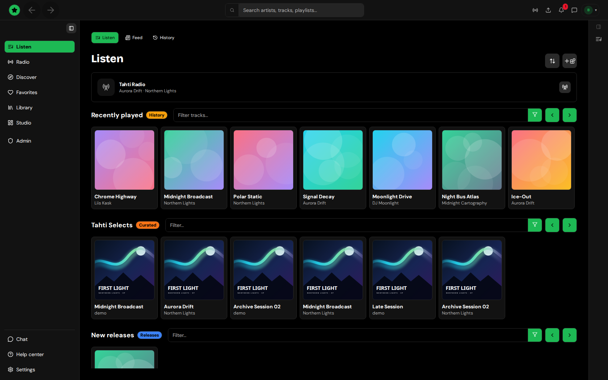

# Tahti Player Documentation

Tahti Player is the app for [tahti.live](https://tahti.live), a nonprofit broadcasting platform for independent artists. It is free, open source, and has no ads or tracking. The same app runs in the browser at [beta.tahti.live](https://beta.tahti.live) and as a desktop app for Linux, macOS and Windows. The desktop app adds a library for the music files on your computer and a few local integrations.

This documentation is for both users and developers.

<figure><figcaption><p>Tahti Player — Listen home</p></figcaption></figure>


Tahti Player started as a fork of [Nuclear](https://github.com/nukeop/nuclear). The desktop app now shows the same interface as the web app; the old Nuclear plugin pages are kept under "Legacy: Nuclear plugin SDK".


## Links

| Site     | Link                                                                                 |
| -------- | ------------------------------------------------------------------------------------ |
| Website  | [https://tahti.live](https://tahti.live)                                             |
| Web app  | [https://beta.tahti.live](https://beta.tahti.live)                                   |
| GitHub   | [https://github.com/janiluuk/tahti-player](https://github.com/janiluuk/tahti-player) |
| Discord  | [https://discord.gg/M6K43kbMa](https://discord.gg/M6K43kbMa)                         |
| API docs | [https://api.tahti.live/api](https://api.tahti.live/api)                             |

## For users

The user guide is organised by what you want to do:

- **Start here:** [Getting started](user-manual/getting-started.md) and [How Tahti works](user-manual/how-it-works.md)
- **Listening:** [the front page](user-manual/listening/front-page.md), [radio](user-manual/listening/radio.md), [discover and search](user-manual/listening/discover-and-search.md), [channels and artists](user-manual/listening/channels-and-artists.md), [the player](user-manual/listening/player.md), [favorites](user-manual/listening/favorites.md), [playlists](user-manual/listening/playlists.md), [listening together](user-manual/listening/jam.md)
- **For artists:** [Studio: getting started](user-manual/studio/getting-started.md), then uploads, releases, your channel, broadcasting, shows and events, stats and earnings, posts and moderation
- **Your account:** [Settings](user-manual/account/settings.md), [membership and governance](user-manual/account/membership-and-governance.md), [notifications and support](user-manual/account/notifications-and-support.md), [add-ons](user-manual/account/add-ons.md), [themes](themes/themes.md)
- **Desktop app:** [installation](user-manual/desktop/installation.md), [your local music](user-manual/desktop/local-library.md), [remote control](user-manual/desktop/remote-control.md), and the MCP, MPD and Discord integrations
- **Reference:** [keyboard shortcuts](user-manual/reference/keyboard-shortcuts.md), [command line](user-manual/reference/command-line.md), [troubleshooting](user-manual/reference/troubleshooting.md)

The in-app **Help center** has short task guides too, and **H** on any page starts a guided tour.

## What is in this repo?

A pnpm and Turborepo monorepo. The main packages:

- `@tahti-player/tahti-web` - the app: beta.tahti.live and the desktop window
- `@tahti-player/player` - the desktop shell (Tauri, Rust)
- `@tahti-player/ui` - shared UI components
- `@tahti-player/storybook` - component demos
- `@tahti-player/tahti-cli` - the `tahti` command-line tool
- `@tahti-player/themes` - the theme engine
- `@tahti-player/audio-core`, `audio-editor`, `audio-rack`, `visualizer` - audio packages ported from theDAW
- `@tahti-player/hifi` - HTML5 audio engine
- `@tahti-player/model` - shared data model
- `@tahti-player/i18n` - translations
- `@tahti-player/plugin-sdk` - Nuclear's plugin SDK (legacy; the app no longer loads these plugins)
- `@tahti-player/plugin-registry` - the runtime plugin registry
- `@tahti-player/tailwind-config`, `eslint-config`, `tools` - shared config and build tools
- `@tahti-player/docs` - this documentation
- `@tahti-player/website` - tahti.live

## For developers

### Tech highlights

- TypeScript and React 18
- Tauri 2 for the desktop shell
- Vite, TanStack Router and Zustand
- Tailwind v4, configured in CSS (`@theme`/`@layer`), no `tailwind.config.js`
- Vitest and React Testing Library
- The app talks to the Tahti API ([api.tahti.live](https://api.tahti.live/api)), which lives in a separate repository

### Common workspace tasks

Run these from the repo root. You need Node 24 and pnpm; Rust and the Tauri system packages are only needed for the desktop app.

```bash
pnpm dev:tahti      # Run the web app (no Rust needed)
VITE_FORCE_MOCK=1 pnpm dev:tahti  # Same, with mock data instead of the API
pnpm dev            # Run the desktop app in dev mode
pnpm dev:remote     # Same, but reachable from other devices on your network
pnpm storybook      # Run Storybook
pnpm build          # Build all packages
pnpm lint           # Lint all packages
pnpm type-check     # TypeScript checks
pnpm test           # Run all tests
pnpm test:coverage  # Run tests with coverage
pnpm tauri          # Tauri CLI for the desktop app
```
