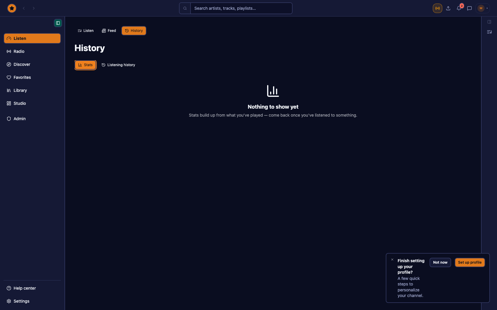

# Listening stats

The **Stats** tab in **Listen → History** turns your history into:

- **Top artists**, **Top tracks** and **Top channels** for the range you pick (the last 30 days to start).
- **Time of day** and **Day of week**: when you listen.
- **Listening calendar**: a year of days, darker on days you listened more. On a narrow screen it opens on the latest weeks.

<figure><figcaption>
Stats — tops, time of day, and calendar
</figcaption></figure>

If nothing was played in the chosen range, it says so instead of showing empty charts.
