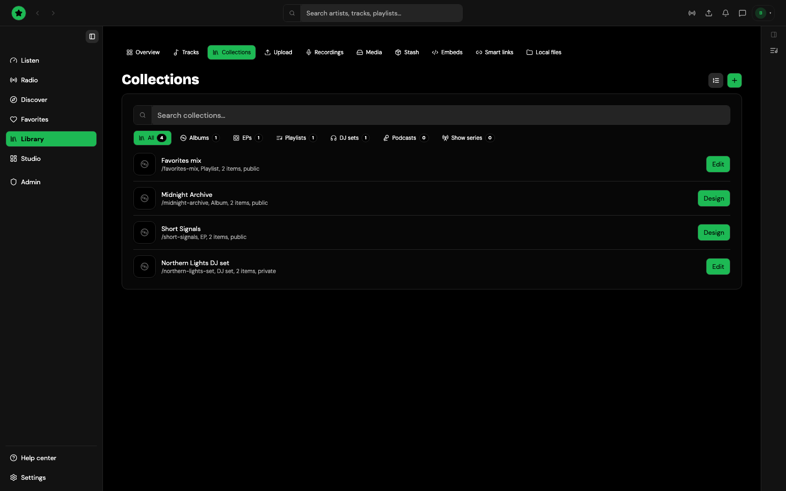

# Playlists

## Tahti playlists

Your playlists live in **Library → Collections**. To add a track, use **Add to playlist** in the player bar, or the **+** on a track row. The panel that opens lists your playlists and has **New playlist** at the bottom. A playlist's page plays it in order, shuffles it, or adds it to the queue.

<figure><figcaption>
Library → Collections — playlists and albums
</figcaption></figure>

Artists use the same Collections page for releases and albums, with the album designer for the cover and track list.

## Playlists of your own files (desktop app)

In the desktop app, **Library → Local files** keeps playlists of the music on your computer: create, rename, duplicate and delete them, reorder tracks, import and export M3U/M3U8, and play or shuffle them. **Smart playlists** there fill themselves from rules (genre, rating, BPM, key, date added and more) and update as your library changes.
