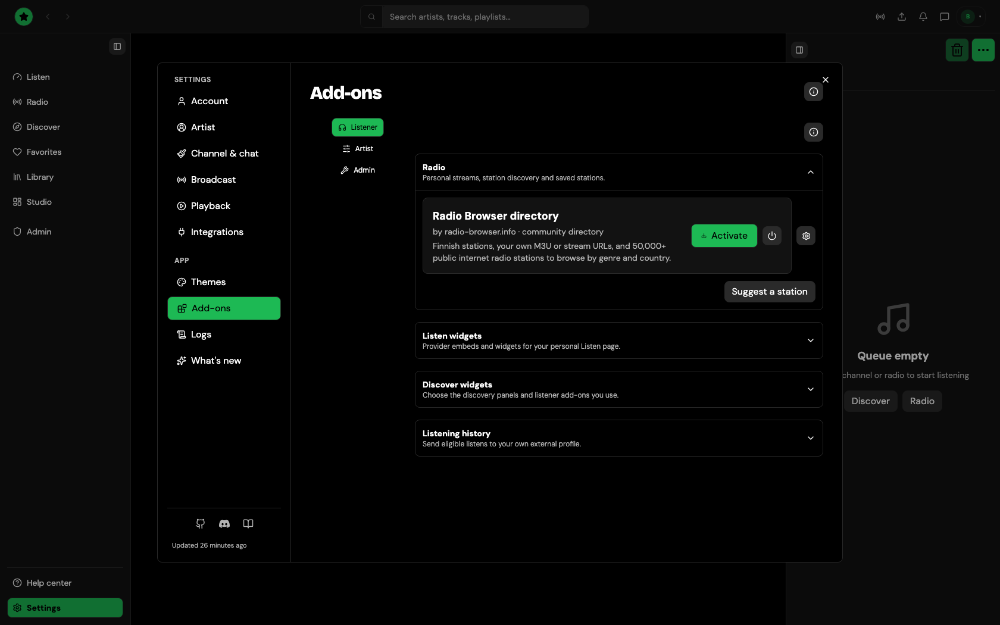

# Plugins and providers

Tahti Player plays Tahti's own catalogue out of the box; nothing has to be installed first. Add-ons extend it.

## Add-ons

Open **Settings → Add-ons**. The categories are Themes, Visualizers, Import, Multicast, Fingerprinting, Audio tools, Radio, Embed, Discovery, Channel and Playback; artists and the board see a few more for their own tools. Only add-ons that work today are listed, each with a state:

<figure><figcaption>
Settings → Add-ons
</figcaption></figure>

- **Ready:** works end to end.
- **Importer ready** or **Search ready:** the connect or search half works and the rest (usually a server-side import) is still coming; the row says what is missing.

**Import** brings music in from other services (for example hearthis.at sets, SoundCloud or Mixcloud). Tracks from hearthis.at, Mixcloud, Spotify and Bandcamp are referenced, not copied: Tahti keeps a link and the provider's own player plays them.

**Discovery** holds Disco-widgets: small sandboxed add-ons you can put on Listen. Artists can put them on their channel and profile pages.

## Integrations

**Settings → Integrations** connects outside services: ListenBrainz and Last.fm scrobbling, and in the desktop app the local servers (Tahti Jam, MCP, MPD) and Discord Rich Presence.

## Where add-ons come from

The catalogue of add-ons and themes is the public [tahti-registry](https://github.com/janiluuk/tahti-registry) on GitHub. Themes can also be made in Settings → Themes and submitted for review.

Writing an add-on: see [Tahti add-on and plugin authoring](../plugins/tahti-web-authoring.md).
