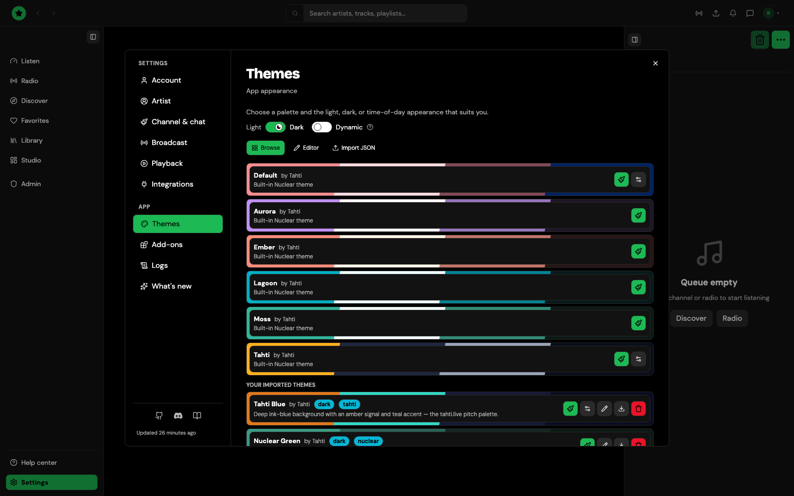

# Themes

Open **Settings → Themes**.

<figure><figcaption>
Settings → Themes
</figcaption></figure>

- The **light / dark** switch at the top changes the mode. **Dynamic** switches by itself: dark from 7 pm to 7 am, light the rest of the day.
- **Browse** lists the themes you can apply: the [built-in themes](themes-basic.md) and the community themes that ship with the app. Click one to apply it.
- **Editor** builds a theme from colours, fonts, corners, borders and shadows, with a live preview.
- **Import JSON** adds a theme from a JSON file; see [Advanced themes](themes-advanced.md) for the format.

Themes you import or make appear under **Your imported themes**, where you can rename, configure or delete them, or [submit one to the community catalogue](theme-store.md).
