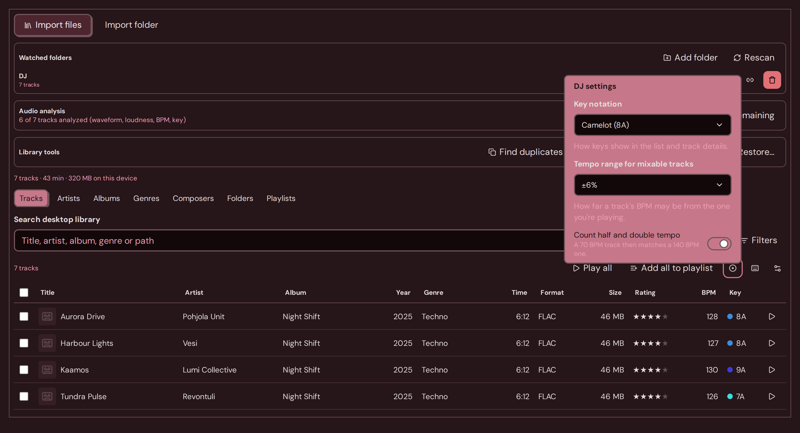
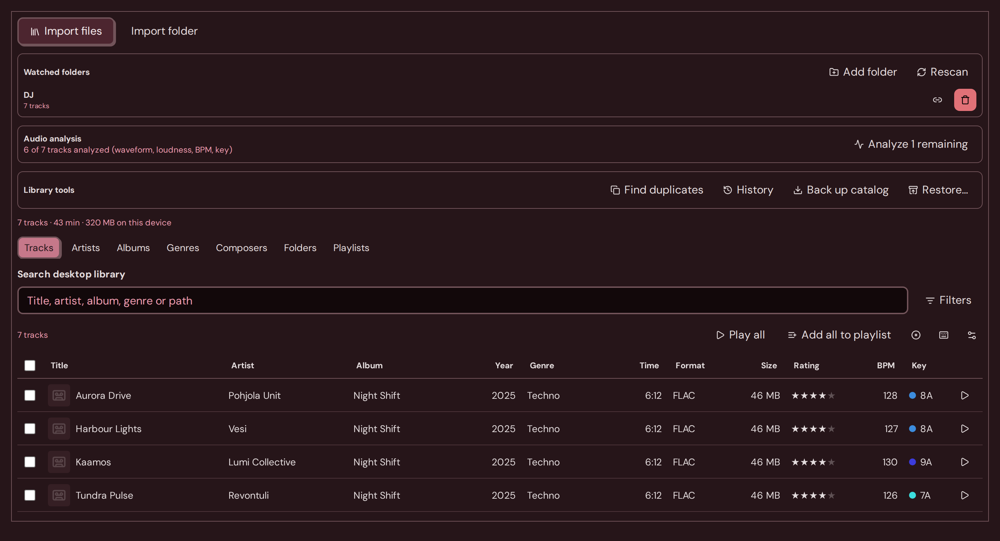
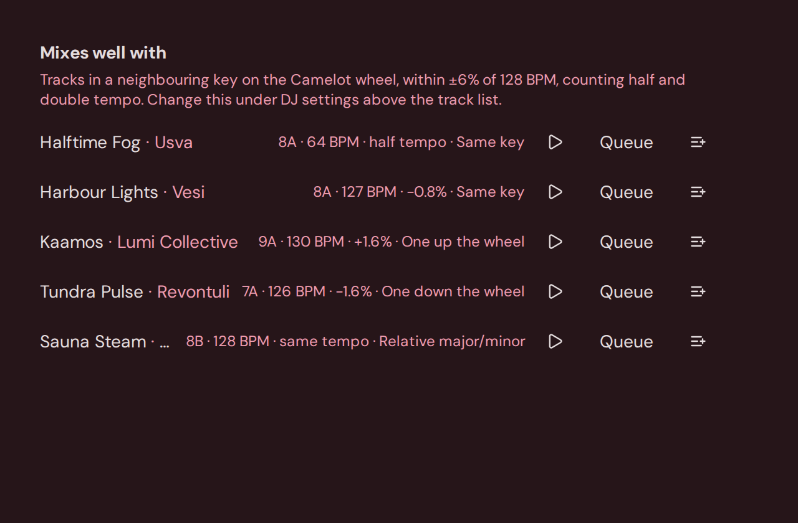
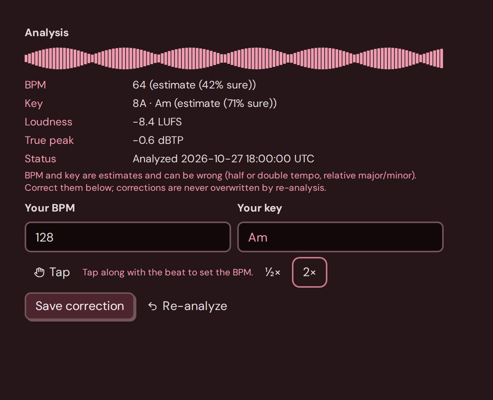
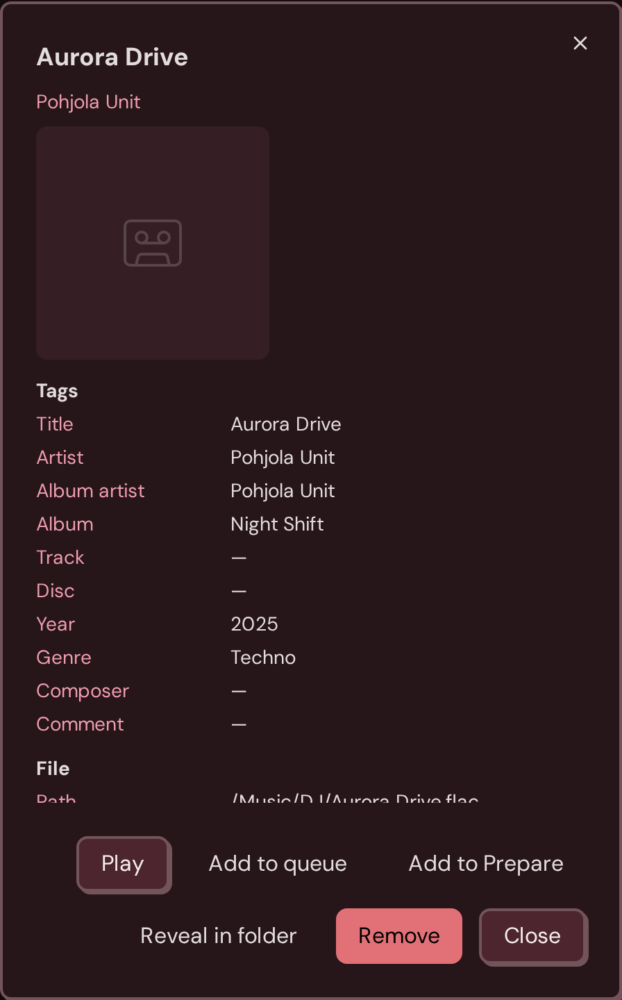
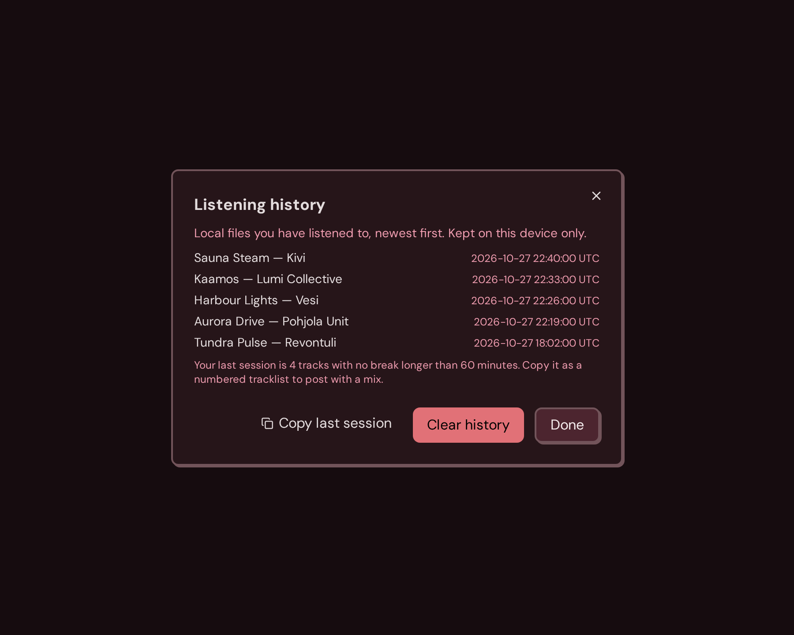

# Mixing your local library

**Library → Local files** in the desktop app can show keys the way a DJ reads them, find tracks that sit next to the one you are playing, and keep a short list for the next set. Analyse the library first (BPM, key, and loudness) so these tools have something to read.


These tools belong to the desktop app. In the browser, **Library → Local files** only lists files you pick for that session, and it does not analyse BPM or key.


## DJ settings

Above the track list, the disc icon opens **DJ settings**.

<figure><figcaption><p>DJ settings above the track list</p></figcaption></figure>

**Key notation** chooses how a key is written in the track list, in track details, in **Mixes well with**, and in a smart-playlist key rule:

| Setting | How A minor looks |
| --- | --- |
| Musical (Am) | Am |
| Camelot (8A) | 8A |
| Open Key (1m) | 1m |

The key is stored once. Changing the setting only changes the label. The same choice follows you onto a track page's **Key** row.

**Tempo range for mixable tracks** is how far another track's BPM may sit from the one you are looking at: **±3%**, **±6%** (the starting choice), or **±8%**.

**Count half and double tempo** is on to start with. A 70 BPM track can then match a 140 BPM one. Turn it off when you only want the printed tempo.

## The Key column

<figure><figcaption><p>The Key column. Neighbouring keys use neighbouring colours.</p></figcaption></figure>

A key the app can read has a colour dot. The colour follows that key's place on the wheel, twelve steps around the circle, so keys that mix look close in colour. Hover a cell to see the key as it is stored.

A value the app cannot read (for example a word that is not a key) is shown as typed, with no dot. An empty key shows an em dash.

## Mixes well with

Open a track with **I**, or **Details** on the row. **Mixes well with** lists other tracks in your library that fit.

<figure><figcaption><p>Mixes well with, for a track in 8A at 128 BPM</p></figcaption></figure>

A match can be:

- the **same key**
- **one step** either way on the wheel
- the **relative major or minor**

When the track has a BPM, the match also has to fall inside the tempo range from DJ settings. With **Count half and double tempo** on, a track at half or double that BPM counts too.

The section needs a BPM or a readable key. If both are missing, it asks you to analyse the track or set them first. If nothing in the library fits, widen the tempo range or analyse more tracks.

Each row shows the key in your notation, the BPM, how far the tempo sits (including **half tempo** or **double tempo**), and the relationship: **Same key**, **One up the wheel**, **One down the wheel**, or **Relative major/minor**. From the row you can play the track, press **Queue**, or add it to Prepare.

## Correct the BPM and the key

In the same details panel, **Analysis** shows the estimate. Estimates can be half or double the tempo you hear, or the relative major or minor. **Your BPM** and **Your key** are yours.

<figure><figcaption><p>Tap, half, and double. Saving keeps your number through the next analysis.</p></figcaption></figure>

**Tap** along with the beat. A couple of taps sets a BPM. Wait about two seconds and the next tap starts a new count. The result has to land between 40 and 300.

**½×** and **2×** halve or double the number in **Your BPM**, and they stay inside 40–300. If halving or doubling would leave that range, that button does nothing.

Leave **Your BPM** blank, or type **0**, and save to clear a BPM you set earlier.

**Your key** accepts a musical name (Am, F#, Bbm), a Camelot code (8A), or an Open Key code (1m). Anything else shows **Use a key like Am, F#, Bbm, 8A or 1m.** and **Save correction** stays off. The same check applies to **Filters → Key (e.g. Am, F#, 8A)**: unknown text blocks **Apply**. An empty key filter is fine.

A smart-playlist key rule uses a menu that follows **Key notation**. With Camelot selected, an option reads **8A · A minor**.

**Save correction** keeps your BPM and key. Analysing the file again does not overwrite them. A saved BPM is marked **your correction**. **Undo** on the confirmation puts the previous correction back.

## The Prepare playlist

**P**, once the track list has focus, adds the focused track to a local playlist named **Prepare**. If the focused track is part of a larger selection, **P** adds the whole selection. The details panel has **Add to Prepare**, and so does each row under **Mixes well with**.

<figure><figcaption><p>Add to Prepare from the track details</p></figcaption></figure>

The first time, the app creates **Prepare**. Tracks already on that playlist are left where they are. A confirmation says how many tracks were added, and whether the playlist is new.

The keyboard list (the keyboard icon above the table) includes **P**. See [Keyboard shortcuts](../reference/keyboard-shortcuts.md).

## Copy the last session

**Library tools → History** lists local listens on this computer, newest first. A listen counts after 30 seconds of a local track. This list is separate from [Listening history](../listening/history.md), which is the plays kept for your account.

<figure><figcaption><p>Copy last session from local listening history</p></figcaption></figure>

**Copy last session** copies the newest run of those listens as a numbered tracklist, oldest first. A gap longer than 60 minutes ends the session, so an earlier listen stays in the full list and stays out of the copy. Times in the copy are your local time:

```
01. 22:19 Pohjola Unit – Aurora Drive
02. 22:26 Vesi – Harbour Lights
```

The confirmation says **Tracklist copied.**
