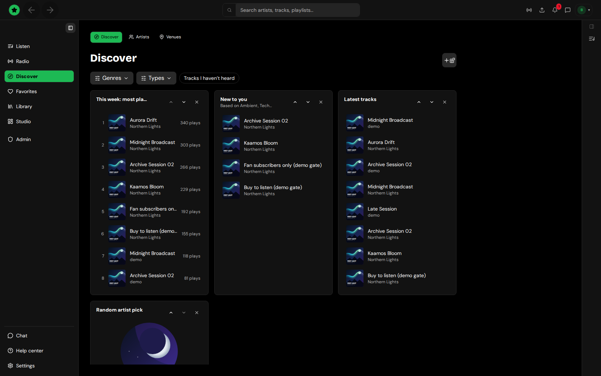

# Discover and search

**Discover** (in the sidebar) has three tabs:

- **Discover:** a page of widgets you arrange yourself (**Add a widget**), such as "This week: most played". Filters narrow it to tracks you haven't heard, to a kind of content, or to the last 1 to 30 days.
- **Artists:** the artist directory, with search and filters.
- **Venues:** clubs and places that stream on Tahti.

<figure><figcaption>
Discover
</figcaption></figure>

Listen also shows Disco-widgets you installed from Settings → Add-ons → Discovery.

## Search

The search box in the top bar finds artists, tracks and playlists as you type:

- Use the arrow keys to move through the suggestions and **Enter** to open one.
- Press **Enter** without choosing a suggestion to open the full results page (`/search?q=…`) with every matching artist, track and playlist or release.
- A tag on a track page opens all tracks with that tag (`/search?tag=…`).

