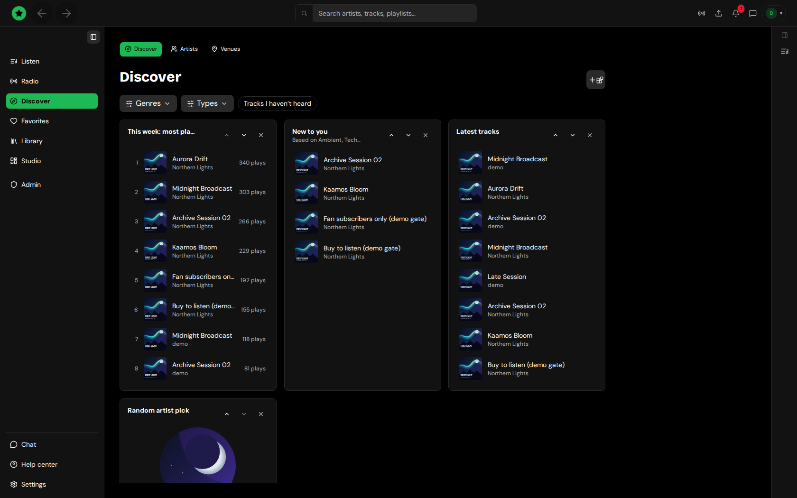

# Discover and search

**Discover** (in the sidebar) has five tabs:

- **Discover:** a page of widgets you arrange yourself (**Add a widget**), such as "This week: most played".

  **From Tahti** leads the page: the latest news from the Tahti team, as cards with the headline over the picture. Press a card to read the post.

  **Genres** and **Types** open chips that narrow the widgets to the genres and kinds of content you pick. Track rows in widgets show the artist's avatar beside their name, and a track without a cover shows the default artwork. Press a row to play it; hold **Shift** to add it to the queue instead. The **Random track** widget plays something new from the genres you pick (it remembers them).
- **Feed:** **Community stories** first, the newest posts from every artist, then **Your feed**: posts and releases from artists you follow. Stories are cards with the title over the picture (the post's own, or the artist's newest track cover, or their avatar). Press a story to read it in full: the whole post, its pictures and link, and the other community updates beside it, with **Newer** and **Older** to move through them. The author's name opens their profile.
- **Artists:** the artist directory, with search and filters.
- **Groups:** public artist groups (collectives with a shared playlist), with **Search groups**. See [Groups](../studio/groups.md).
- **Venues:** clubs and places that stream on Tahti.

<figure><figcaption>
Discover
</figcaption></figure>

Listen also shows Disco-widgets you installed from Settings → Add-ons → Discovery.

## Event calendar

**Discover → Feed → Calendar** shows every public event in a month: a month grid on larger screens, a list on phones. Cancelled events stay listed, struck through. Open an event for its page with the time, place, who plays, tickets, **Add to Google Calendar** and a subscribe link; **Subscribe to the calendar (.ics)** adds the whole calendar to your calendar app.

## Search

The search box in the top bar finds artists, tracks and playlists as you type:

- Use the arrow keys to move through the suggestions and **Enter** to open one.
- Press **Enter** without choosing a suggestion to open the full results page (`/search?q=…`) with every matching artist, track and playlist or release.
- A tag on a track page opens all tracks with that tag (`/search?tag=…`).

Tracks in search results and on tag pages play right there, with the same track rows as elsewhere: play, add to queue, love and add to a playlist. A track only fan subscribers or buyers can hear shows a lock (**Members** or **Buy**) and opens its track page, which explains how to get it.

