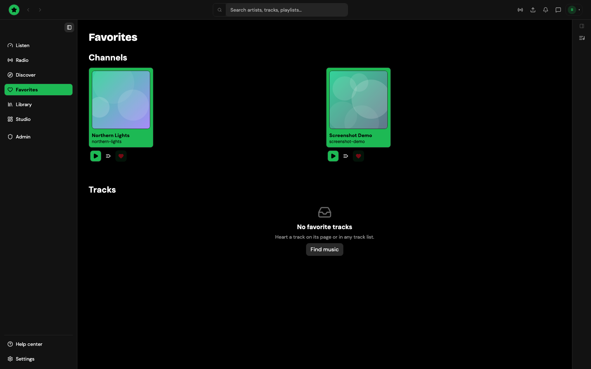

# Favorites

Press the heart on a track to like it, or choose **Like** in a track's **⋯** menu. Likes are saved to your Tahti account, so they show on every device. Press the heart on a channel or radio station to keep it in **Favorites** (in the sidebar, or the bottom bar on a phone). The page has two parts:

- **Channels** you favorited, with who is live right now, and your favourite radio stations.
- **Liked tracks**: every track you liked, ready to play or add to the queue. The sort icon orders them (title, artist, newest release, shortest or longest first) and remembers your choice.

<figure><figcaption>
Favorites — channels and liked tracks
</figcaption></figure>

Favorited channels and stations are kept for your account in this browser (or the desktop app). Tracks you saved on a device before likes replaced track favourites move to your likes the next time you sign in there. Following an artist is separate: press **Follow** on their channel (see [Channels and artists](channels-and-artists.md)), and their new releases and posts reach **Discover → Feed**.

Signed out, the heart asks you to sign in, and **Liked tracks** shows a sign-in prompt.

## Who you follow

**Settings → Artist** (or **Profile** for listeners) → **Following** lists the artists and channels you follow, each linking to their page. Follow someone from their page; their posts also appear in **Discover → Feed**. A listener opening **Library** lands on **Favorites**.
