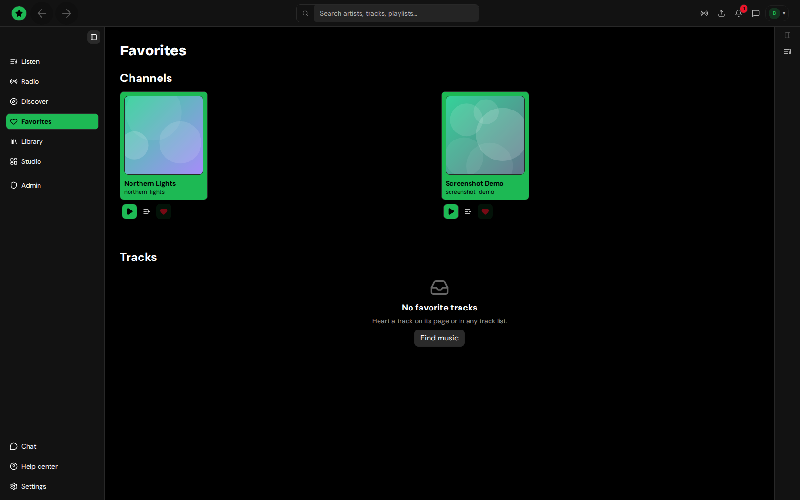

# Favorites

Press the heart on a track or a channel to keep it in **Favorites** (in the sidebar, or the bottom bar on a phone). The page has three parts:

- **Channels** you favorited, with who is live right now.
- **Tracks** you favorited, ready to play or add to the queue. **Sort** orders them (title, artist, newest release, shortest or longest first) and remembers your choice.
- **Liked on Tahti**: tracks you liked while signed in, from your Tahti account. It only shows when you have some.

<figure><figcaption>
Favorites — channels, tracks, and likes
</figcaption></figure>

Favorited channels and tracks are kept for your account in this browser (or the desktop app). Following an artist is separate: press **Follow** on their channel (see [Channels and artists](channels-and-artists.md)), and their new releases and posts reach your **Feed**.

Signed out, the heart asks you to sign in.
