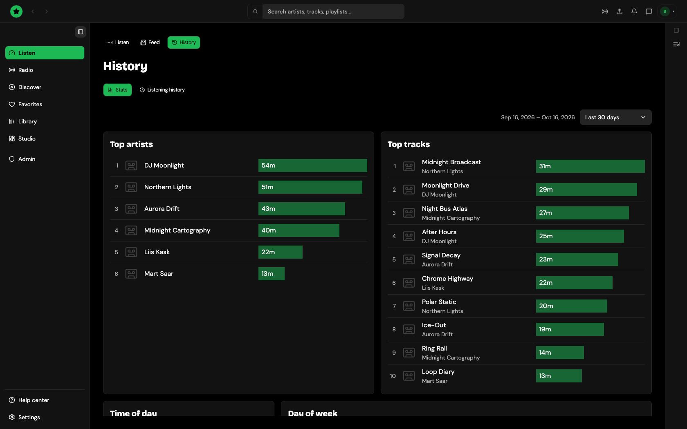

# Listening history

**Listen → History** (`/listen/history`) lists what you have played, newest first, with a **Stats** tab next to it (see [Listening stats](stats.md)). A track you played several times appears once, at its latest play.

<figure><figcaption>
Listen → History
</figcaption></figure>

The history is kept for your account in this browser (or the desktop app). It is not uploaded to Tahti: artists see anonymous play counts, never who listened.
