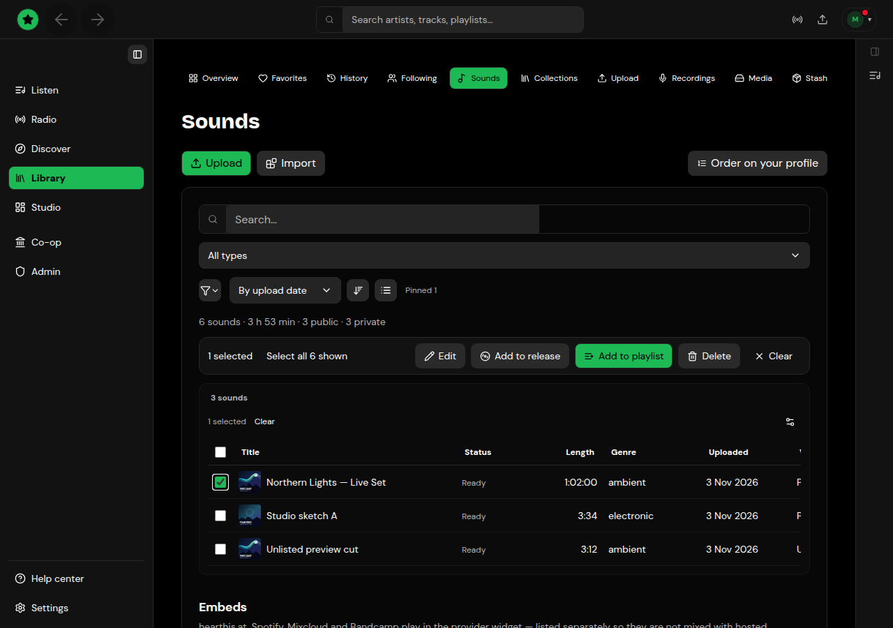

# Uploads and tracks

## Upload

Open **Studio → Upload** (or **Library → Upload**), or press **Upload** on **Library → Sounds**.

1. Choose an audio file: FLAC, WAV, AIFF, MP3, M4A or OGG, up to 4 GB. If the file isn't audio, the upload is refused with "This file is not an audio file" and the formats you can use.
2. Press **Upload**. If you don't give a title, the file name becomes the title; you can change it afterwards.
3. You're taken to the track's page while it processes.

Uploads without artwork get a cover from the board's artwork gallery automatically, and so do tracks imported from SoundCloud, hearthis.at or Google Drive and saved broadcast recordings. To change a cover, open its cover slot: **Upload** an image, or pick one from the gallery of artwork and your own uploaded images.

Lists of tracks have one toolbar: filter, the sort icon (a menu of orders), and **Track size** (the icon button beside it) to show bigger or more compact rows. After you create a playlist or add tracks to a release, the confirmation has **Undo**.

## Processing

While a track is being processed (just uploaded, or re-processed after an edit), it shows a **Processing** spinner: on its page in place of the waveform, and on its row in **Library → Sounds**. You can edit its details meanwhile, but it can't be played or added to a release until it's ready.

- The blue light at the top left lists everything still processing.
- A notification links to the track when it's done.
- If processing fails, the track says why and offers **Retry processing**.

## Edit a track

The track page (`/studio/sounds/<id>`) opens read-only, with these tabs:

- **Playlists:** the **Sets** and **Groups** cards add the track to your playlists and to [groups](groups.md) you belong to.
- **Insights:** plays and listeners for this track. See [Stats and earnings](stats-and-earnings.md).

Press the pencil (**Edit details**) to add the **Details** tab: title, content type, description, release date, a **Genre** card (**Main genre** and **Sub-Genres**), a **Tags** card, **Audience** (Private, Unlisted or Public), **Allow downloads** and **Allow comments**. Press **Save**, then the check (**Done editing**) to go back to the read-only view.

The header buttons pin the track to your profile, open the audio editor (quick fixes such as auto-trim, and mastering) and more actions.

## Who can listen and download

The track's edit dialog has three tabs: **Basics** (title, artist, the **Genre**, **Tags**, **Sets** and **Groups** cards and the rest of the details; DJ sets also get **Tracklist**), **Sharing**, and **Advanced** (the audio file and its quick fixes, export to other services, and the remaining settings). In **Sharing**:

- **Visibility:** Private (only you and share links), Unlisted (anyone with the link) or Public.
- **Share links** for private tracks: send a private link to someone without making the track public.
- **Access:** limit a track to buyers or fan subscribers, or put it on sale.
- **Download gates:** ask listeners to follow you or share the track before downloading.

## Import from other services

**Settings → Add-ons → Import** connects SoundCloud, Mixcloud and hearthis.at (and Bandcamp once its API is approved). Imports are queued; **Import progress** on the Upload page shows each one as Queued, Importing, Imported (with a link to the track) or Failed (with the reason).

Tracks from hearthis.at, Mixcloud, Spotify and Bandcamp can also be linked rather than copied: Tahti keeps the link and the provider's player plays them.

The **Import** group starts with a short guide, **How to import your tracks from another service**: install the service's add-on, connect it, pick tracks, sets or playlists and press **Import**.

To turn hearthis.at embeds into real uploads, enable downloads for those tracks on hearthis.at, then use **Host the audio on Tahti** in a track's edit dialog, or replace every hearthis.at embed in your library at once with the command line: `tahti hearthis import-embeds` (see [Command line](../reference/command-line.md)).

### Mikseri.net

Music you have on [Mikseri.net](https://www.mikseri.net) can be added to a collection as an embed. Open the collection in **Studio** and find **Add your music from Mikseri.net**:

1. Paste the Mikseri track page (`mikseri.net/artists/<artist>/<song>/<id>/`), the official track embed URL, or the numeric track ID. Artist pages aren't accepted, only song pages.
2. Enter the track title and artist name, and optionally a genre (used by collection filters).
3. Turn on **Rights confirmed** (you own the track or have permission to embed it) and add it.

Tahti stores only the embed reference and your details; the audio stays on Mikseri.net and plays in its player.

If the board has blocked your uploads, Upload and the import panels say so instead of starting an import.

## Library → Sounds

Open **Library → Sounds** to browse everything you've uploaded or imported.

<figure><figcaption>
Library → Sounds — filters, stats, and bulk actions
</figcaption></figure>

### Browse and filter

- A short summary under the header shows how many sounds match the current filters, total duration, and how many are public, private, processing or failed.
- Search by title, filter by **source** (Tahti audio, hearthis.at, Mixcloud, and so on), **content type**, **Genre**, **Tag** and upload date range. The **Genre** and **Tag** lists show how many of your sounds have each one. The sort icon and **Track size** change order and row density. Switch between card layouts and a **list view** (table with checkboxes).
- The list pages from the server as you scroll or press **Load more** — filters apply to the whole library, not only the rows already on screen.

### Select and bulk actions

In **list view**, tick the checkbox on one or more hosted tracks. A toolbar appears with:

- **Select all N matching** — selects every sound that matches the current filters (not just the loaded page). Use this before a large delete or edit.
- **Edit** — set the same genre, tags, content type or visibility on every selected sound.
- **Add to release** / **Add to playlist** — same as for a single track.
- **Mix order** (two or more selected) - suggests an order for a smooth DJ mix: the slowest track with a key first, then each time the closest key on the Camelot wheel and tempo. Tracks without a key go at the end. Nothing changes until you press **Add to a playlist in this order**.
- **Delete** — removes the selected sounds after you confirm. If you used **Select all matching**, the delete covers the whole filtered set; if the library changed since you selected, you'll be asked to refresh and try again.
- **Clear** — drops the selection.

Embeds (linked SoundCloud, Mixcloud, and similar) stay in the list for browsing and playback, but bulk edit and delete apply to hosted Tahti audio.

### Covers for embeds

An embed with no stored cover shows the service's own artwork when Tahti can find it (hearthis.at, Mixcloud, Spotify, Bandcamp, SoundCloud, YouTube), otherwise the default artwork, never an empty square. When you open your own library, a cover found this way is saved on the track, so it loads straight away next time. **Fill missing covers** in Library → Sounds does the same for your whole library at once: it asks each service first and gives the rest a cover from the artwork gallery, then tells you how many came from each. Tahti also runs this every night for embeds that still have no cover. Mikseri.net has no public artwork, so Mikseri embeds always get a gallery cover.

### One track

Open a row for the track page, or use the row menu to edit details, pin to your profile, download, or delete a single sound.

## Other Library tabs

- **Recordings:** your past broadcasts, ready to publish as tracks.
- **Media:** images and video you've uploaded for covers and backdrops. **Purge unused** deletes every file nothing of yours uses any more (profile, channel design, posts, releases, overlays); it shows how many files and how much space first, and never touches files in use.
- **Stash:** private file storage you can share with collaborators.
- **Embeds:** SoundCloud and other embeds you've added.
- **Smart links:** the share pages for your releases.
